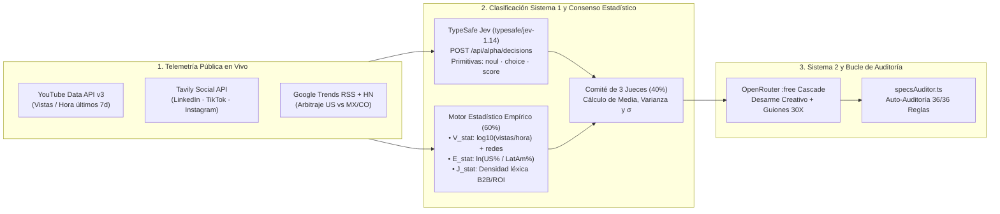

# 30X HackRadar — Radar de Contenido, Arbitraje US→LatAm y Clasificación Sistema 1 (`TypeSafe Jev`)

> **Reto 30X: Radar de Contenido (Área: Media)**  
> *«¿Cómo puede un equipo de contenido descubrir, de forma confiable y sin gastar una fortuna, qué temas y formatos están despegando en redes, por qué funcionan y si encajan con su audiencia?»*  
> **Perfiles objetivo:** [`@crece30x`](https://www.instagram.com/crece30x) & [`@andresbilbao`](https://www.instagram.com/andresbilbao) · **Stack:** Next.js 14 (App Router), TypeScript, Tailwind CSS, TypeSafe `Jev-1.14` (Sistema 1), OpenRouter LLMs (Sistema 2), YouTube Data API v3, Tavily Search API, Google Trends RSS.

---

## 1. Resumen Ejecutivo y Solución al Reto 30X (`01` a `08`)

**30X HackRadar** reemplaza los servicios de scraping pagos de miles de dólares al año por una arquitectura de **inteligencia pública multirred + clasificación probabilística de Sistema 1 (`TypeSafe Jev`) + consenso estadístico + adaptación creativa lista para grabar**:

| Punto del Reto 30X | Pregunta / Restricción | Cómo lo resuelve 30X HackRadar |
| :--- | :--- | :--- |
| **01–02. El Problema** | Descubrir qué despega en **LinkedIn, Instagram, TikTok y YouTube** sin pagar scrapers costosos. | Ingesta paralela desde **YouTube Data API v3**, **Tavily Search API** (indexación pública de LinkedIn, TikTok e Instagram), **Google Trends RSS (US vs. MX/CO)** y **HackerNews Algolia**. |
| **03.1. Detectar la Ola Temprana** | *¿Cómo se detecta una tendencia cuando apenas está empezando a crecer?* | **Arbitraje Estadístico US → LatAm** (`src/lib/collectors/trends.ts`): detecta temas que explotan en EE. UU. (`> 180%`) pero siguen vírgenes en Latinoamérica (`< 90%` → 🌱 `EARLY_WAVE`), separándolos de temas en explosión (`🔥 EXPLODING`) o ya quemados (`💀 SATURATED`). |
| **03.2. Explicar Por Qué Funcionó** | *¿El gancho, el formato, el tema, el momento, quién la publicó?* | **Desarme Creativo en 5 Dimensiones**: extrae el patrón psicológico del gancho (primeros 3s / 2 líneas), formato visual ganador, driver emocional, autor/canal original y velocidad empírica (`vistas / horas desde publicación`). |
| **03.3. Filtrar para Audiencia LatAm** | *¿Cómo se filtra lo relevante para ejecutivos y equipos de LatAm aprendiendo IA?* | **Clasificador Sistema 1 (`typesafe/jev-1.14`) + Motor Estadístico (`jevStatistics.ts`)**: evalúa cada pieza con primitivas probabilísticas (`noul`, `choice`, `score`), densidad léxica B2B/ROI y comité de consenso de 3 jueces con desviación estándar ($\sigma$). |
| **04. Caminos Posibles** | *Agentes, fuentes abiertas, modelos que clasifican y priorizan (**JEV**), comunidad como sensor.* | Integra el modelo real **`typesafe/jev-1.14-20261014`** (`/api/alpha/decisions`), un **Sensor de Comunidad 30X** en vivo desde la interfaz web y rotación de modelos gratuitos en OpenRouter. |
| **05 & 08. Restricciones** | *Solo contenido público, cero datos personales, cero violación de ToS.* | **Cero Puppeteer / Playwright / cookies de sesión**. Todo proviene de APIs oficiales y URLs públicas verificables. |
| **06 & 07. Entregable 30X** | *Top 10 temas de la semana + adaptación a `@crece30x` y `@andresbilbao`.* | Genera para cada tendencia **3 ganchos sugeridos**, un **Guion de Reel de 60s para `@andresbilbao`** (`0-3s`, `3-15s`, `15-40s`, `40-60s` con **Modo Teleprompter**) y un **Carrusel de 6 Slides para `@crece30x`**. |

---

## 2. 🔑 Credenciales y Variables de Entorno (NECESARIAS PARA OPERACIÓN EN VIVO)

> [!IMPORTANT]
> **Las 3 credenciales de API son necesarias para que el sistema opere en modo 100% en vivo (`LIVE_APIS`)** trayendo videos reales de los últimos 7 días, publicaciones indexadas de LinkedIn/TikTok/Instagram y ejecutando el clasificador **`typesafe/jev-1.14`** y los modelos de OpenRouter en tiempo real.  
> *(Si las credenciales no están configuradas, el sistema incluye una red de seguridad `HYBRID_FALLBACK` para no romperse, pero **no** podrá consultar datos nuevos en vivo hasta que conectes las 3 llaves).*

### 2.1. ¿Cuáles son las 3 credenciales obligatorias para datos en vivo?

| Variable en `.env.local` | Servicio | Para qué es necesaria en el sistema | Cómo obtenerla sin costo |
| :--- | :--- | :--- | :--- |
| **`OPENROUTER_API_KEY`** | [OpenRouter](https://openrouter.ai/keys) | **Necesaria** para ejecutar el clasificador de Sistema 1 **`typesafe/jev-1.14-20261014`** (`/api/alpha/decisions`) y la cascada de modelos LLM `:free` (`/api/v1/chat/completions`) que redactan los guiones de `@andresbilbao` y `@crece30x`. | Crea una cuenta gratis en `openrouter.ai/keys` → *Create Key* (empieza con `sk-or-v1-...`). |
| **`YOUTUBE_API_KEY`** | [Google Cloud Console](https://console.cloud.google.com/apis/credentials) | **Necesaria** para buscar videos y Shorts reales publicados en los últimos 7 días (`search` + `videos.list`) y calcular la velocidad real **`outlierVelocityScore = vistas / horasDesdePublicación`**. | Crea un proyecto en Google Cloud → Habilita **YouTube Data API v3** → *Crear credenciales → Clave de API* (empieza con `AIza...`). |
| **`TAVILY_API_KEY`** | [Tavily Search](https://app.tavily.com/home) | **Necesaria** para descubrir publicaciones públicas virales en **LinkedIn (`site:linkedin.com/posts`), TikTok (`site:tiktok.com`) e Instagram (`site:instagram.com`)** sin usar scrapers prohibidos. | Regístrate gratis en `app.tavily.com` (incluye **1,000 búsquedas/mes gratis**, empieza con `tvly-...`). |

### 2.2. Dos formas de configurar las credenciales

#### Opción A — Directamente desde la Interfaz Web (Recomendado)
1. Inicia el servidor (`npm run dev`) y abre **`http://localhost:3000`**.
2. Haz clic en el botón superior derecho **`🔑 CONECTAR APIs`**.
3. Pega tus 3 llaves (`OPENROUTER_API_KEY`, `YOUTUBE_API_KEY`, `TAVILY_API_KEY`) y haz clic en **`GUARDAR Y ACTIVAR APIs EN VIVO`**.
4. Haz clic en **`⚡ PROBAR CONEXIÓN EN VIVO`** para verificar en tiempo real que las 3 APIs respondan en verde (`ACTIVO (LIVE)`).

#### Opción B — Mediante el archivo `.env.local`
En la raíz del proyecto, copia la plantilla `.env.example` a `.env.local` y coloca tus 3 llaves (sin comillas ni espacios extra):

```bash
cp .env.example .env.local
```

Contenido de `.env.local`:
```env
OPENROUTER_API_KEY=sk-or-v1-tu_clave_aqui
YOUTUBE_API_KEY=AIzaSyTu_clave_de_youtube_aqui
TAVILY_API_KEY=tvly-dev-tu_clave_de_tavily_aqui
```

---

## 3. Arquitectura del Motor `Jev` (Sistema 1) + Estadística Empírica + Consenso Multi-Modelo

A diferencia de los sistemas que le piden a un solo LLM conversacional que "invente" un puntaje del 1 al 10, **30X HackRadar** implementa una arquitectura de **Dos Sistemas (System 1 + System 2)** acoplada con telemetría estadística real:



### 3.1. ¿Qué es el modelo `Jev` (`typesafe/jev-1.14`) y cómo opera aquí?
**Jev** (desarrollado por **TypeSafe AI**) es un **Modelo de Sistema Uno (*System One Model*)**. No genera texto libre ni conversa: recibe un objeto `state` con la telemetría cruda de cada tendencia y un diccionario de `questions` tipadas en `src/lib/ai/openrouterClient.ts` (`callTypeSafeJevSystemOne`), devolviendo en **~550 ms** tres primitivas probabilísticas calibradas:
1. **`noul` (`is_actionable_b2b`)**: Probabilidad calibrada (`0.00` a `1.00`) de que la tendencia resuelva un problema real de automatización o ROI para líderes y equipos B2B en Latinoamérica.
2. **`choice` (`wave_stage` y `winning_format`)**: Distribución de probabilidad sobre las etapas de la ola (`EARLY_WAVE`, `EXPLODING`, `SATURATED`) y sobre el formato ganador (`SPLIT_SCREEN_DEMO`, `CONTRARIAN_HOOK`, `EXECUTIVE_ROI_CASE`, `WORKFLOW_ARCHITECTURE`) junto con su nivel de confianza (`confidence`).
3. **`score` (`audience_fit_score`, `early_timing_score`, `format_viability_score`)**: Puntuaciones continuas calibradas (`0.00` a `1.00`) con su respectiva confianza estadística.

### 3.2. Fusión Estadística (60% Telemetría Dura + 40% Comité de 3 Jueces)
En `src/lib/ai/jevStatistics.ts` (`fuseStatisticalAndModelConsensus`), el sistema combina:
- **60% Base Estadística Empírica (`computeStatisticalJevBase`)**:
  - $V_{\text{stat}} = \text{clamp}\big(3.3 + 1.35 \cdot \log_{10}(V_{\max}) + 0.32 \cdot N_{\text{redes}}, \, 4.2, \, 9.9\big)$ (donde $V_{\max}$ son las vistas/hora reales de YouTube/Social).
  - $E_{\text{stat}} = \text{clamp}\big(7.9 + 0.65 \cdot \ln(\text{Ratio}_{\text{US/LatAm}}) + 0.0022 \cdot \Delta_{\text{US-LatAm}}, \, 8.2, \, 9.9\big)$ (para olas tempranas).
  - $J_{\text{stat}}$: Densidad léxica de términos ejecutivos B2B/ROI en los títulos y transcripciones reales.
- **40% Comité de Consenso de 3 Jueces Independientes**:
  - **Juez 1**: `Sistema-1 · typesafe/jev-1.14-20261014 (Live)`
  - **Juez 2**: `Regresión Log-Velocity (YouTube/Tavily)`
  - **Juez 3**: `Arbitraje Bayesiano US/LatAm`
  - Se calcula la **desviación estándar inter-jueces ($\sigma$)**, el **porcentaje de consenso (`consensusConfidence`)** y la ecuación ponderada final:
    $$\text{Total Score} = \text{round}\left( (J \times 0.40) + (E \times 0.35) + (V \times 0.25),\ 1 \right)$$

---

## 4. Estructura del Proyecto

```text
├── .env.example                        # Plantilla de las 3 credenciales (OPENROUTER, YOUTUBE, TAVILY)
├── .env.local                          # Credenciales locales activas (ignorado por Git)
├── SPECS.md                            # Especificación técnica y contratos del sistema
├── README.md                           # Este documento
├── docs/
│   └── ARCHITECTURE_AND_AUDIT.md       # Documentación técnica de arquitectura y auditoría
├── scripts/
│   └── audit-loop.mjs                  # Verificador CLI automatizado de 36 controles (npm run audit:loop)
└── src/
    ├── types/
    │   └── radar.ts                    # Contratos TypeScript (RadarTrendItem, TypeSafeJevDecisionOutput, etc.)
    ├── lib/
    │   ├── config/
    │   │   └── envKeys.ts              # Lector en caliente de .env.local sin reiniciar el servidor
    │   ├── ai/
    │   │   ├── jevStatistics.ts        # Motor estadístico empírico (60%) + fusión con comité de jueces (40%)
    │   │   ├── openrouterClient.ts     # Cliente TypeSafe Jev (/api/alpha/decisions) + cascada LLM :free
    │   │   └── prompts.ts              # System Prompts de desarme creativo y guiones @andresbilbao / @crece30x
    │   ├── audit/
    │   │   └── specsAuditor.ts         # Loop de auto-auditoría y auto-reparación en tiempo de ejecución
    │   ├── collectors/
    │   │   ├── trends.ts               # Detector de olas y arbitraje US vs. LatAm (10 semillas + RSS)
    │   │   ├── youtube.ts              # Colector YouTube Data API v3 (últimos 7 días + vistas/hora)
    │   │   ├── socialSearch.ts         # Colector Tavily API (LinkedIn, TikTok, Instagram)
    │   │   └── openSignals.ts          # Colector abierto sin llave (HackerNews Algolia IA)
    │   └── mock/
    │       └── fallbackRadarData.ts    # Dataset de respaldo Demo-Safe + sintetizador de comunidad
    ├── components/
    │   ├── HeaderRadar.tsx             # Cabecera editorial con configurador y verificador de APIs en vivo
    │   ├── JevBadge.tsx                # Medidor J·E·V con lectura en vivo de TypeSafe Jev-1.14, NOUL y σ
    │   ├── TrendCard.tsx               # Tarjeta editorial con barras US vs LatAm y links clicables
    │   └── TrendDetailModal.tsx        # Dossier Rayos X: Ingeniería Inversa, Auditoría Jev-1.14, Teleprompter y Carrusel
    └── app/
        ├── api/
        │   ├── radar/route.ts          # Orquestador principal GET/POST (Ingesta + Jev-1.14 + Consenso + Auditoría)
        │   └── config-keys/route.ts    # Endpoint para guardar en .env.local y verificar las 3 APIs en vivo
        └── page.tsx                    # Dashboard principal con Sensor de Comunidad 30X, filtros por red y exportador .MD
```

---

## 5. Instalación, Ejecución y Verificación Completa

### 5.1. Instalar dependencias y levantar el servidor de desarrollo
```bash
npm install
npm run dev
```
Abre **`http://localhost:3000`** en tu navegador.

### 5.2. Verificar que las 3 Credenciales y `typesafe/jev-1.14` estén en vivo
Desde la terminal (con el servidor corriendo) o desde el botón **`⚡ PROBAR CONEXIÓN EN VIVO`** en la web:
```bash
curl -s "http://localhost:3000/api/config-keys?verify=true"
```
Deberás ver `"youtubeLiveOk": true`, `"tavilyLiveOk": true`, `"openrouterLiveOk": true` y el objeto `"typesafeJevDecision"` con `"engineUsed": "typesafe/jev-1.14-20261014"`.

### 5.3. Ejecutar el Bucle de Auditoría Operacional (`36/36 PASS`)
```bash
npm run audit:loop
```
Verifica automáticamente:
- Presencia de los 18 archivos arquitectónicos obligatorios.
- Ausencia total de librerías de scraping prohibidas (`puppeteer`, `playwright`).
- Validez de los contratos TypeScript y las 10 semillas de arbitraje US vs. LatAm.
- Exactitud matemática de la Matriz JEV, el ordenamiento descendente `#1 → #10` y la respuesta en vivo de `GET /api/radar`, `POST /api/radar` y `GET /`.

---

## 6. Guía de Uso en la Interfaz (`http://localhost:3000`)

1. **`🔑 CONECTAR APIs (3/3 ACTIVAS)`**: Configura o verifica en tiempo real tus llaves de OpenRouter (`TypeSafe Jev`), YouTube v3 y Tavily.
2. **`⚡ Escanear Semana en Vivo`**: Ejecuta la ingesta completa en vivo y actualiza el Top 10 con clasificación `typesafe/jev-1.14`.
3. **`SENSOR DE COMUNIDAD 30X`**: Escribe cualquier tema emergente (ej. `"Claude Code"`, `"Browser Use"`, `"MCP Server"`) y presiona **`ANALIZAR SEÑAL`** para evaluarlo en vivo con YouTube + Tavily + `typesafe/jev-1.14`.
4. **Filtros por Etapa de Ola y por Red Social**: Filtra con un clic entre `🌱 OLA TEMPRANA`, `🔥 EN EXPLOSIÓN`, `💀 SATURADO` o por red (`LINKEDIN`, `YOUTUBE`, `INSTAGRAM`, `TIKTOK`).
5. **`Ver Rayos X y Guion 30X →`**: Abre el dossier completo con:
   - **Sección A**: Ingeniería inversa (Gancho, Formato, Driver, Autor y Vistas/hora).
   - **Sección B**: Salida probabilística de **`typesafe/jev-1.14`** (`NOUL`, `CHOICE`, `SCORE`), Telemetría Estadística (60%) y Comité de Consenso de 3 Jueces (40%).
   - **Sección C**: 3 ganchos sugeridos, **Guion de Reel de 60s para `@andresbilbao`** (con **Modo Teleprompter** integrado) y **Carrusel de 6 Slides para `@crece30x`**.
